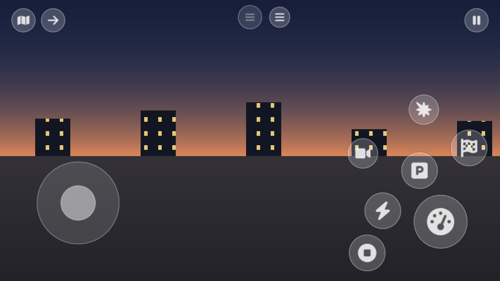
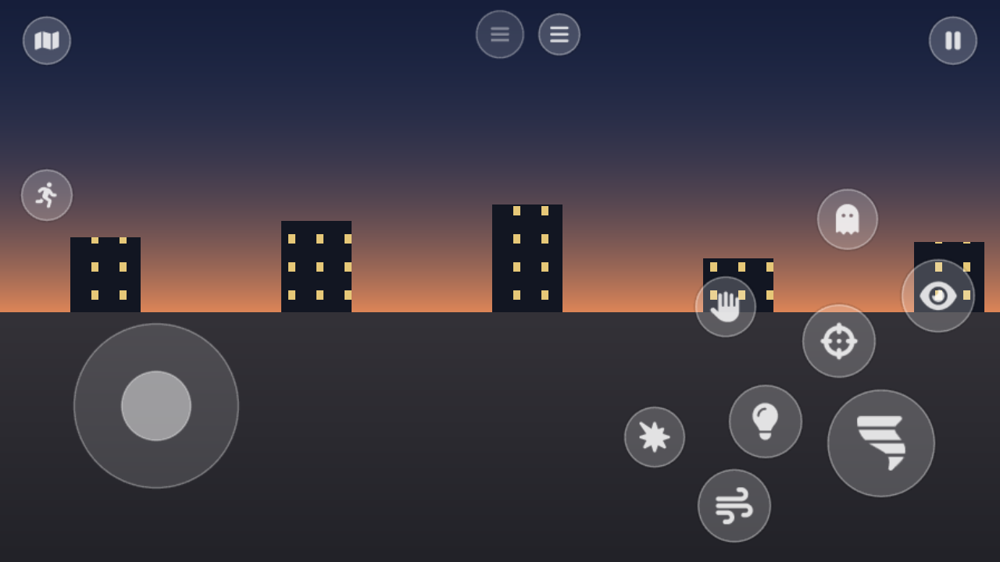
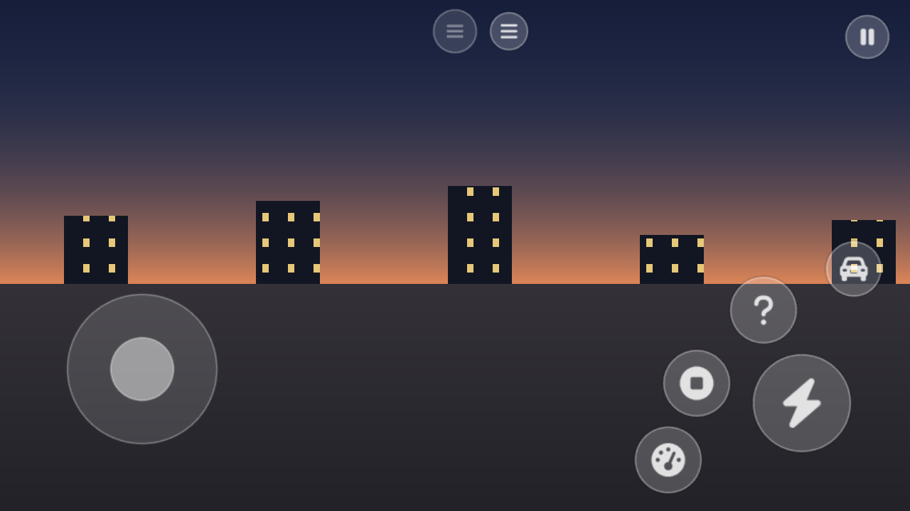
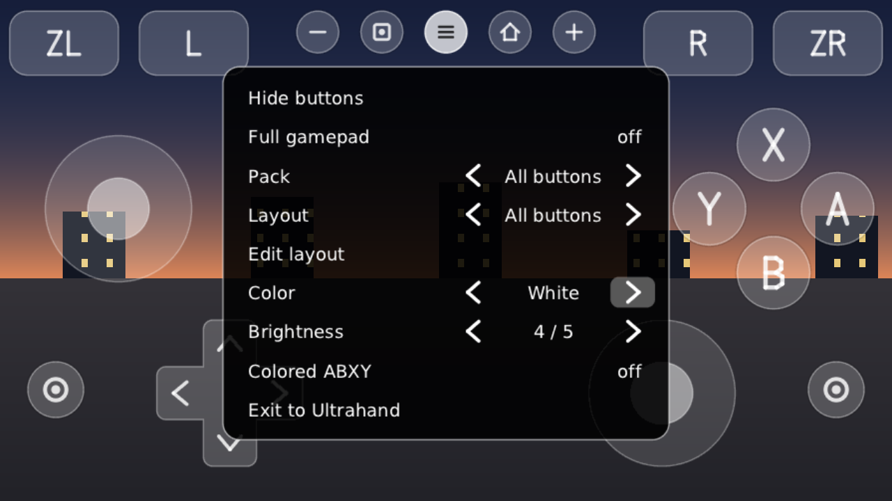

# touchpad_nx

Экранный геймпад для Nintendo Switch: оверлей под Ultrahand / Tesla, который рисует кнопки
поверх игры и превращает касания в нажатия виртуального Pro Controller. Играть можно вообще
без джойконов.

*On-screen touch gamepad for Nintendo Switch (an Ultrahand / Tesla overlay) with per-game
button packs. Docs are in Russian; the overlay's own menu is in English.*

## Всё модульное

Кнопки собраны в **наборы** под конкретные игры. Набор — обычный текстовый файл: кладёшь его
на карту, и он сам включается для своей игры. Свой набор делается в блокноте, без
программирования и без пересборки оверлея: [docs/PACKS.md](docs/PACKS.md).

Что умеет кнопка набора:

- **раскладки и переходы** — «игра», «меню», «гонка», и кнопки, которые их меняют;
- **плавающий стик** — появляется там, куда опустился палец;
- **защёлка** — тап включил, тап выключил (газ, прицел, бег);
- **турбо** — держишь кнопку, она сама часто нажимается;
- **кнопка со стиком** — зажал и повёл пальцем: и нажатие, и наводка одним пальцем;
- **несколько клавиш разом** — например газ вместе с бустом;
- **меню без кнопок** — раскладка может отдать касания самой игре;
- 46 встроенных значков, свой цвет и подпись, если нужно.

А если в игре стоит мод, который сообщает оверлею, что делает герой, раскладки меняются
сами — сел в машину, и кнопки стали кнопками вождения. Механизм в оверлее есть, см. ниже.

## Примеры

Картинки нарисованы на ПК той же программой, что рисует на консоли; фон — заглушка вместо игры.

**Burnout Paradise Remastered.** Буст и ручник нажимают газ сами: палец съезжает с газа на
буст, и машина не сбрасывает скорость.



**Luigi's Mansion 3.** Пылесос наводится тем же пальцем, что держит кнопку.



**Mario Kart 8 Deluxe.** Газ с защёлкой, дрифт под большим пальцем; в меню кнопок нет вовсе,
там работает тач самой игры.



## Установка

Нужно:

- Switch с Atmosphère;
- [Ultrahand Overlay](https://github.com/ppkantorski/Ultrahand-Overlay) или Tesla Menu
  (вместе с ними ставится загрузчик оверлеев nx-ovlloader);
- прошивка 9.0.0 или новее; скрытие касаний от игры работает с 14.0.0.

Проверено на Switch OLED, прошивка 21.2.0, Ultrahand с памятью оверлеев 4 МБ.

Шаги:

1. Скачать `touchpad_nx-<версия>.zip` со страницы [Releases](../../releases).
2. Распаковать в корень карты памяти. Папки `switch` и `config` из архива сольются с теми,
   что уже есть на карте; оверлей окажется в `/switch/.overlays/touchpad.ovl`.
3. Вставить карту, загрузить консоль, запустить игру.
4. Открыть Ultrahand → **Overlays** → **TouchPad**.

Набор под игру включится сам. Если для игры набора нет, будет обычный полный геймпад; другой
выбирается в меню оверлея (`≡` → Pack).

Джойконы лучше снять: игра видит экранный геймпад как отдельный Pro Controller, и игры на
одного игрока при пристёгнутых джойконах могут его не принять.

Обновление — заменить `touchpad.ovl` новым. Удаление — стереть `/switch/.overlays/touchpad.ovl`
и папку `/config/touchpad`.

## Наборы

Внутри оверлея уже есть:

| набор | игра | раскладки | проверен на консоли |
|---|---|---|---|
| Mario Kart 8 | Mario Kart 8 Deluxe | меню, гонка | нет |
| Luigi's Mansion 3 | Luigi's Mansion 3 | игра, меню | нет |
| Burnout Paradise | Burnout Paradise Remastered | езда, меню | нет |
| All buttons, Platformer, D-pad, Minimal | любая игра | по одной | да |

Непроверенные наборы собраны по раскладкам кнопок самих игр; если какая-то кнопка в них жмёт
не то, это одна буква в файле набора.

Набор под игру включается сам, когда она запущена. Для остальных игр берётся набор по
умолчанию; выбранный вручную набор запоминается для этой игры.

Свои наборы лежат в `/config/touchpad/packs/<имя>.ini`. Файл с именем встроенного набора
заменяет его. Готовые наборы как примеры лежат в архиве в `/config/touchpad/examples/` (это
копии [packs/](packs)).

Сам по себе оверлей не видит, что происходит в игре: раскладки меняются от кнопок набора и
вручную. Если раскладка разошлась с игрой, рядом с `≡` есть круглая кнопка, которая меняет
раскладку, ничего не нажимая. А если набор совсем не подходит, в меню оверлея есть
«Full gamepad».

### Когда раскладки меняет сама игра

Оверлей умеет читать из памяти игры небольшой блок с флагами («за рулём», «в меню», …) и по
нему включать нужную раскладку: набор задаёт для раскладок правила `when=`. Блок должен писать
мод внутри игры; оверлею всё равно, какая это игра и как мод устроен. Формат блока и правила:
[docs/STATE.md](docs/STATE.md). Готовых модов в этом репозитории нет.

## Управление

| Элемент | Что делает |
|---|---|
| Стики | Палец, опущенный в круг (или в зону плавающего стика), становится нейтралью |
| Крестовина | Восемь направлений, палец можно перекатывать |
| Соседние кнопки | Палец между двумя кнопками жмёт обе |
| `≡` коротко | Открыть меню оверлея (если кнопки скрыты — вернуть их) |
| `≡` держать 0,8 с | Выйти в Ultrahand |
| Комбинация Ultrahand | Тоже выход в Ultrahand; читается из его конфига, работает и с экранных кнопок |

## Меню оверлея



Меню на английском.

- **Hide buttons** — остаётся только `≡`, касания снова идут в игру.
- **Full gamepad** — поверх набора игры встаёт обычный полный геймпад (набор «All buttons» в
  том виде, как его расставил игрок). Запасной выход, если в каком-то месте игры набору не
  хватает кнопки. Второй тап возвращает раскладку набора; выбор игры при этом не меняется.
- **Pack** — переключение наборов. Выбор запоминается для запущенной игры; без игры он
  становится набором по умолчанию.
- **Layout** — переключение раскладок внутри набора вручную.
- **Edit layout** — редактор: кнопки перетаскиваются пальцем, тап выбирает кнопку,
  `−` / `+` меняют размер, «Hide» убирает её. «Save» пишет набор на карту, «New» делает его
  копию, «Cancel» или `≡` возвращает как было. Добавлять кнопки и менять их действия — в
  файле набора.
- **Color**, **Brightness**, **Colored ABXY** — оформление. Кнопки со своим цветом из набора
  остаются своего цвета.
- **Exit to Ultrahand** — оверлей закрывается, меню Ultrahand открывается сразу.

Когда игра закрывается, оверлей убирается сам: на экране HOME кнопок нет, Ultrahand ждёт
как обычно. Если запустить оверлей до игры, он останется и дождётся её.

Одновременно загрузчик держит один оверлей, поэтому меню Ultrahand поверх пада открыть
нельзя: пад уступает ему место, вернуться — один тап по TouchPad в списке.

## Файлы на карте

Всё лежит в `/config/touchpad/`:

- `settings.ini` — цвет (`color=#RGB`), яркость 1–5, набор по умолчанию и набор каждой игры
  по её title id.
- `packs/<имя>.ini` — наборы: свои и изменённые в редакторе.
- `log.txt` — журнал последнего запуска: прошивка, title id игры, выбранный набор, строки
  наборов, которые не удалось понять.

Раскладки из `profiles/` от версии 0.2 подхватываются для общих наборов с тем же именем
(`full`, `platformer`, `dpad`, `minimal`), пока в `packs/` нет файла новее. Профиль, который
0.2 запомнила для игры, уступает набору этой игры, если такой набор есть.

## Как устроено

- `core/` не зависит от свича: наборы и их текстовый формат, перевод касаний в состояние
  геймпада, меню и редактор, растеризатор, значки, текст и отрисовка с перерисовкой только
  изменившихся областей. Покрыто тестами на ПК.
- `packs/` — наборы под игры. Они вшиваются в оверлей при сборке и одновременно служат
  примерами формата.
- `source/` — обвязка под libnx: слой 896×504 RGBA4444 на весь экран (если памяти не
  хватило — 640×360), виртуальный контроллер через `hid:dbg` HDLS, отключение тача для игры
  через `hid:sys` 507, чтение отчёта мода из памяти игры через `dmnt:cht`.
- `assets/` — значки действий: SVG из Font Awesome Free и список, по которому
  `tools/make_icons.py` собирает их в `core/icon_data.bin`.
- `tools/` — рисует оверлей на ПК, без консоли.
- Поток ввода опрашивает тач каждые 4 мс и не ждёт экран; поток отрисовки ~30 раз в секунду
  проверяет, изменилась ли картинка, и перерисовывает только тогда. Оба потока засыпают на
  каждом проходе: поток сисмодуля, который не засыпает, вешает консоль.
- Если игра не принимает ещё один контроллер, система его отключает. Оверлей подключает его
  заново при следующем нажатии, не чаще раза в секунду.

## Сборка и тесты

```bash
DEVKITPRO=~/devkitpro/opt/devkitpro make
```

```bash
make -C tests test
```

Картинки всех раскладок всех наборов, без свича:

```bash
make -C tools packs
```

## Диагностика чтения памяти игры

Если на карте есть файл `/config/touchpad/probe.txt`, оверлей при выходе в Ultrahand один раз
подключается к игре через сервис читов Atmosphère (`dmnt:cht`), пишет в `log.txt` размеры её
памяти и скорость чтения и отключается. Это заготовка под переключение раскладок по тому, что
на самом деле происходит в игре. Убрать файл — выключить.

## Значки

Картинки действий на кнопках — [Font Awesome Free](https://fontawesome.com) 6.7.2, лицензия
CC BY 4.0 (текст в [assets/fontawesome/LICENSE.txt](assets/fontawesome/LICENSE.txt)). В оверлей
они попадают перекрашенными и уменьшенными. Все значки с именами — в
[docs/PACKS.md](docs/PACKS.md).

## Чужое в этом проекте

- Значки — [Font Awesome Free](https://fontawesome.com), CC BY 4.0.
- Шрифтовой растеризатор — [stb_truetype](https://github.com/nothings/stb) (public domain / MIT).
