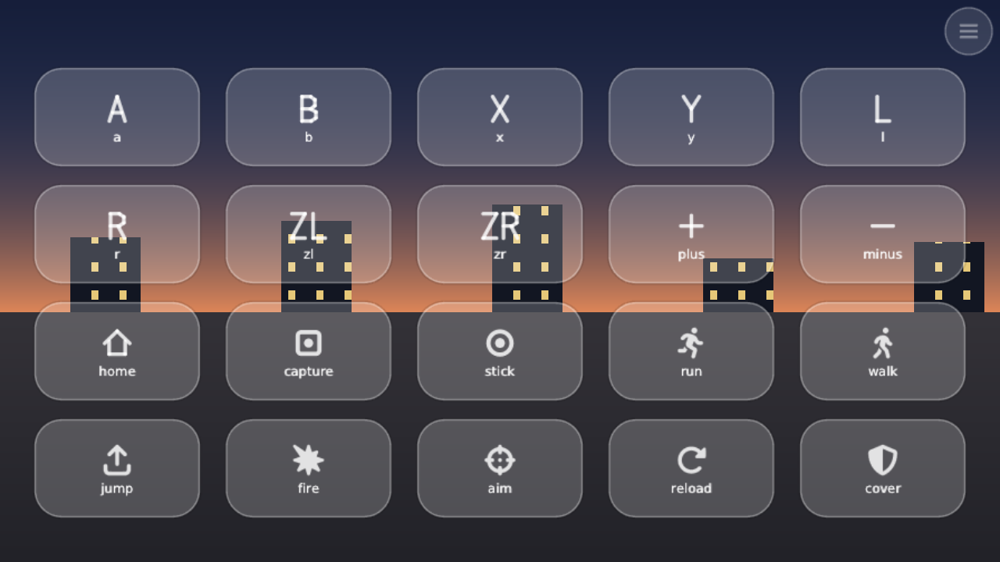
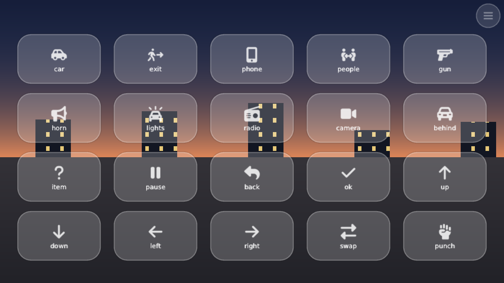
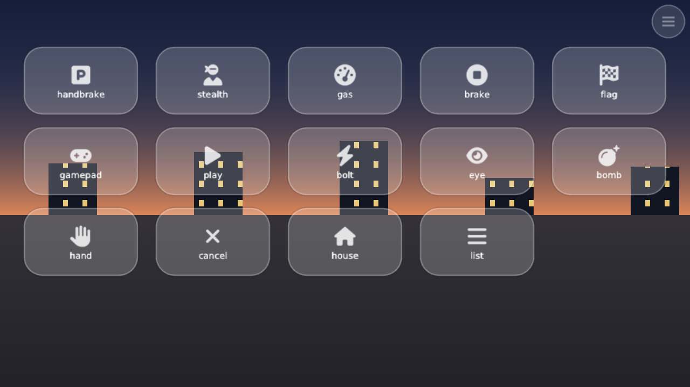

# Как сделать набор кнопок под игру

Набор — один текстовый файл `.ini`. В нём одна или несколько раскладок (например «пешком»,
«в машине», «меню») и правила перехода между ними. Файл кладётся на карту в
`/config/touchpad/packs/`, оверлей подхватывает его при следующем запуске.

Готовые примеры: [packs/lm3.ini](../packs/lm3.ini), [packs/burnout.ini](../packs/burnout.ini)
и [packs/mk8d.ini](../packs/mk8d.ini).
Проще всего скопировать один из них под новым именем и править.

## Имя файла

Имя файла без `.ini` — это id набора: `mk8d.ini` → `mk8d`. Только строчные латинские буквы,
цифры, `_` и `-`, не длиннее 15 символов. Файл с тем же именем, что у встроенного набора
(`mk8d`, `lm3`, `burnout`, `full`, `platformer`, `dpad`, `minimal`), заменяет встроенный.

## Общий вид

```ini
[pack]
name=Моя игра
author=я
games=0100152000022000
start=play

[play]
name=Игра
stick_l=200,520,105 | zone=0,200,560,720
btn=A | 1150,560,70 | label=ГАЗ | color=#4E6 | mode=toggle
btn=PLUS | 1220,48,32 | icon=pause | goto=menu

[menu]
name=Меню
touch=game
btn=NONE | 772,44,76,28 | label=ИГРА | goto=play
```

Экран — 1280×720, `x` вправо, `y` вниз. Строки с `;` или `#` в начале — комментарии.

## Раздел `[pack]`

| ключ | что значит |
|---|---|
| `name` | название в меню оверлея |
| `author` | кто сделал |
| `games` | title id игр через запятую; для них набор включается сам |
| `start` | раскладка, с которой набор начинается (по умолчанию первая в файле) |

Title id игры пишется в `/config/touchpad/log.txt` в строке `game ...` при каждом запуске
оверлея поверх игры.

Какой набор включится: сначала тот, что игрок сам выбрал для этой игры в меню оверлея, потом
набор, в чьём `games` есть игра, потом набор по умолчанию.

## Раскладки

Каждый следующий раздел — раскладка; имя раздела — её id (те же правила, что для имени файла).
В наборе до 6 раскладок, в раскладке до 24 кнопок. Чего в раскладке нет, того нет на экране.

| ключ | что значит |
|---|---|
| `name` | название в меню |
| `when=` | когда раскладка включается сама, см. ниже про отчёт игры |
| `touch=game` | касания видит и игра (для меню, которые сами понимают тач). Без этой строки касания получает только оверлей |
| `menu=x,y` | где стоит кнопка оверлея `≡` (по умолчанию `640,46`) |
| `stick_l`, `stick_r` | левый и правый стик |
| `dpad` | крестовина |
| `btn` | кнопка, по строке на каждую |

### Кнопка

```
btn = КЛАВИШИ | x,y,радиус | свойство=значение | ...
btn = КЛАВИШИ | x,y,полуширина,полувысота | ...
```

Три числа — круг, четыре — прямоугольник со скруглением; `x,y` — центр.

**Клавиши**: `A B X Y L R ZL ZR PLUS MINUS HOME CAPTURE LS RS DUP DDOWN DLEFT DRIGHT`.
Несколько сразу — через плюс: `ZL+ZR`. `NONE` — кнопка ничего не нажимает (нужна, чтобы
только сменить раскладку).

| свойство | что делает |
|---|---|
| `icon=имя` | значок (список ниже) |
| `label=ТЕКСТ` | подпись; если есть и значок, подпись идёт под ним и пропадает, когда не помещается |
| `color=#RGB` | свой цвет кольца, по одной hex-цифре на канал: `#4E6` зелёный, `#F54` красный. Стоит красить одну-две главные кнопки, не все подряд |
| `mode=toggle` | защёлка: тап включил, тап выключил (газ, прицел) |
| `mode=turbo` | пока держишь, кнопка сама нажимается около пяти раз в секунду (бег, который в игре набирается частыми нажатиями) |
| `drag=rs` или `drag=ls` | палец на кнопке ещё и двигает стик: зажал и повёл (огонь с наводкой, колесо оружия) |
| `goto=раскладка` | когда кнопку отпустили, включается эта раскладка. Игра успевает увидеть всё нажатие |
| `goto=back` | вернуться в раскладку, из которой сюда пришли |
| `hidden=1` | кнопка есть, но скрыта; вернуть можно в редакторе оверлея |

Без `icon` и `label` на кнопке рисуется буква клавиши.

Если два круга стоят вплотную, палец между ними жмёт оба. Кнопки с `drag` так не делают:
палец остаётся за той кнопкой, на которую опустился.

При смене раскладки палец, который держит стик, продолжает им управлять. Остальные пальцы
надо поднять и опустить заново, защёлки сбрасываются.

### Стик

```
stick_l = x,y,размер
stick_l = x,y,размер | zone=x0,y0,x1,y1
stick_r = x,y,размер | zone=x0,y0,x1,y1 | hint=0
```

Без `zone` стик стоит на месте. С `zone` он плавающий: палец, опущенный в любом месте
прямоугольника, становится его центром. Тогда `x,y` — только место, где стик нарисован, пока
его не трогают; `hint=0` убирает и этот рисунок (удобно для камеры на всю правую половину).

Кнопки внутри зоны работают как обычно: зона занимает только свободное место.

### Крестовина

```
dpad = x,y,размер
```

## Значки

Первые тринадцать — подписи кнопок геймпада, остальные — картинки действий (Font Awesome
Free). Новую картинку добавить можно: положить SVG в `assets/fontawesome/`, дописать строку в
`assets/icons.txt`, запустить `python3 tools/make_icons.py` и пересобрать оверлей.







## Проверка на компьютере

Свич не нужен: раскладку рисует программа из этого репозитория.

```bash
make -C tools
```

```bash
./tools/build/preview out.ppm pack packs/mk8d.ini race
```

Она пишет картинку 1280×720 и говорит, какие строки файла не поняла и какая из них первая.
После имени раскладки можно дописать точки касаний (`300,560 1170,580`), чтобы увидеть нажатое
состояние. Все раскладки всех наборов из `packs/` сразу:

```bash
make -C tools packs
```

На консоли то же сообщение о непонятых строках попадает в `/config/touchpad/log.txt`.

## Раскладки, которые включает сама игра

Если для игры есть мод, который сообщает оверлею, что делает герой, набор может менять
раскладки по этому отчёту. Что должен делать такой мод, описано в [STATE.md](STATE.md).

```ini
[state]
vehicle=0x1
plane=0x2
pause=0x10000

[foot]
when=!vehicle

[car]
when=vehicle

[air]
when=plane

[menu]
when=pause
```

- В разделе `[state]` набор даёт имена битам отчёта: `имя=число`. Какие биты что значат,
  определяет мод.
- `when=` у раскладки — когда она включается: имена флагов через `&` (все сразу), `!` перед
  именем — флаг должен быть выключен, `|` — «или» между такими группами, до четырёх групп.
- Если подходит несколько раскладок, берётся та, что ниже в файле: сначала общий случай,
  потом частные.
- Раскладка без `when` включается только кнопкой или вручную.
- `hold=1` у раскладки с правилом: кнопка с `goto` может открыть её и при отчёте, и она
  держится, пока из неё не выйдут кнопкой (`goto=back`). Для меню, которое игрок открыл сам.

Пока отчёт есть, кнопки с `goto` на раскладку с правилом её не включают (решает игра), но своё
нажатие в игру по-прежнему отправляют. Отчёта нет — всё работает от кнопок, как раньше.
Включённый в меню оверлея «Full gamepad» и открытый редактор игра не перебивает.

## Чего пока нет

Без мода оверлей не знает, что происходит в игре: раскладки меняются от кнопок набора (`goto`)
и вручную в меню оверлея.
